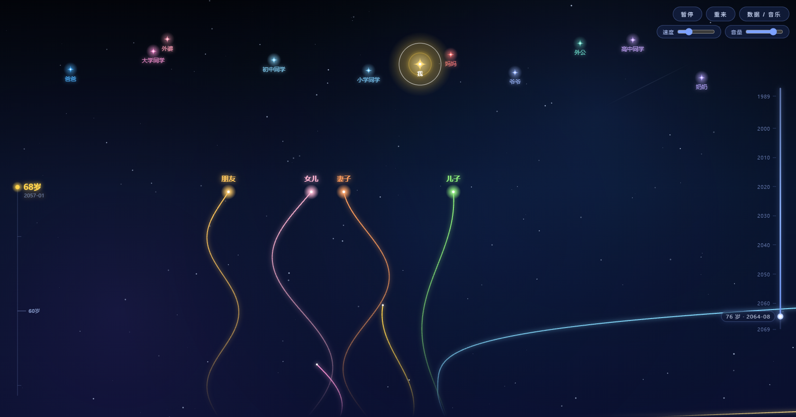

# 人生轨迹线 · Life Trajectory

> 每一个人，都是划过你生命的一道光。
>
> 有的人陪你走一程，有的人陪你走一生；有的人早早地化作天上的星，也有的人，正排着队来到你的路上。

一个用 Canvas 还原抖音「人生轨迹线」视频效果的单文件网页：无依赖、无构建，双击 `index.html` 就能播放。把生命中所有重要的人，写成一条条随时间生长的光线——某一个夏天的初见、某一年的告别、某一年的出生，全部可以精确地落在实际的日历上。

---

## 一、背景

最近抖音上「人生轨迹线」类的视频非常火：画面上方是一片星空，每个人的一生是一条竖着向下生长的线，线在一定高度上笔直延伸、慢慢左右摆动；有人从画面下方飞进来（出生），有人从某人的线上分裂出来（结婚生子），有人中途向侧上方飞走（散了），也有人的线会在某一年的顶端停住，化作一颗星星挂上天空（离开）。一条线突然不再生长的那一年，往往就是视频里最让人鼻子一酸的那一秒。

看着看着就会被打动：一条线 = 一个人的一生，几条线交叉、平行、分开，就是一段完整的人生。于是参考这类视频的视觉语言，做了这个项目：

- **既是作品**：内置了一整套符合常识的人物数据（长辈、同学、同事、朋友、妻儿、老师……），可以直接当一段完整的「人生动画」播放、录屏、分享；
- **也是工具**：所有人物、时间、颜色、入场/离场方式全部写在一段 JSON 里，换成你自己的故事只需要改数据；
- **还能对照现实**：支持设置真实的起止年月（如 `startYM: "1989-01"`），所有「几岁出现 / 几岁离开」都会换算成真实的年份显示在画面与时间轴上——2003 年外公去世、2022 年女儿出生，都能精确对上。

> 目录里的 `人生轨迹.mp4` 是制作时参考的原始视频，仅用于效果对照，不参与运行。

---

## 二、生成过程

**本项目由 AI（WorkBuddy / CodeBuddy 智能助手）全程生成，属于纯粹的 Vibe Coding 产物。**

- 交互方式：**自然语言对话驱动**。每一轮提出想要的效果（例如「让星星挂上天后放大一倍再缩回去」「辅助生命线要能设置出现和消失的水平位置」），由 AI 直接改代码、验证、再交付；没有手写设计稿，也没有逐行人工编码。
- 技术选型：原生 HTML + CSS + JavaScript（ES2020+），**Canvas 2D** 逐帧绘制，全部内联在单个 `index.html` 中；默认背景音乐也以 **base64 字符串**直接写在页面里（`bg.txt` → `make_bg_js.py` → `index.html`），运行时解码为 Blob 交给 `<audio>`，取不到时回落到 WebAudio 实时合成的轻柔长音，**不需要任何第三方库、不需要联网、不需要安装依赖**。
- 实现要点：`requestAnimationFrame` 主循环 + 固定步长积分；所有随时间变化的值都由真实时间（`dt`）驱动，因此 60Hz / 120Hz 屏幕表现一致；轨迹线用「相邻中点 + 二次贝塞尔」绘制，保证任意速度下都圆润无尖角。
- 验证方式：AI 用无头浏览器（Playwright）以手机 / 平板 / 桌面多种视口抓取运行时状态与截图，逐项核对数值（坐标、年份换算、动画时序）后再清理调试脚本，保证交付的文件里没有多余代码。
- 迭代过程：从「画出一条线」到最终形态历经 **33 轮**对话级迭代——每一次意图都被细化成可实现的效果，并回归验证了旧功能不被破坏。

如果你也想改它，最省力的办法就是把想要的效果、或者直接把报错的内容描述给 AI，让它继续迭代；当然，你也可以自己打开 `index.html` 直接改（`Ctrl+F` 搜索注释 `/* ------- */` 的分区即可快速定位）。

---

## 三、快速开始

**目录结构**

```
life-trajectory/
├── index.html        ← 全部代码 + 内置背景音乐都在这一个文件里（HTML + CSS + JS + base64 音乐）
├── bg.txt            ← 内置背景音乐的 base64 文本（换歌时改它，运行不需要）
├── make_bg_js.py     ← 转换脚本：把 bg.txt / mp3 写进 index.html
├── README.md         ← 你正在看的这份说明
├── ScreenShot.png    ← 演示截图
└── 人生轨迹.mp4       ← 制作时参考的原始视频（可删，不影响运行）
```

1. 下载整个目录，**或者只拷贝 `index.html` 这一个文件**（音乐已经打包在里面了）。
2. **双击 `index.html`**，用任意现代浏览器打开（推荐 Chrome / Edge / Safari 最新版）。
3. 点击首屏中间的 **「开 始」**，动画开始播放，同时播放内置背景音乐。
4. 想换成自己的故事：点 **「数据 / 音乐」** → 修改文本框里的 JSON → **「应用数据」**。

> 无需服务器、无需额外文件：`file://` 直接打开即可正常运行（本地音乐上传也支持）。
> 若你想在手机上体验，把这 **一个 html 文件** 传到手机用浏览器打开同样可以，界面已做过移动端适配。

---

## 四、使用教程

### 4.1 界面速览

| 区域 | 位置 | 作用 |
| --- | --- | --- |
| 开始遮罩 | 首屏中央 | 点「开 始」进入动画并启动音乐 |
| 控制面板 | 右上角（手机为底部） | 播放/暂停、重来、数据/音乐、速度、音量 |
| 年龄刻度 | 左上角 | 实时显示「岁数 + 当前年月」，左侧为 5 岁短刻度 / 10 岁长刻度 |
| 时间进度条 | 右侧竖条 | 拖动或点击可跳到任意时间点（手机/桌面一致） |
| 数据抽屉 | 从右侧滑出（手机从底部升起） | 编辑 JSON 数据、设置背景音乐 |

**控制面板**

- **播放 / 暂停**：中途可以随时暂停欣赏某一帧。
- **重来**：从头再播一遍（数据不变）。
- **数据 / 音乐**：打开侧边抽屉，编辑数据或换音乐。
- **速度**：0.3× ~ 3× 播放倍速。
- **音量**：统一控制内置背景音乐、本地音乐与合成兜底音的音量。

**右侧时间进度条**

- 滑块位置 = 当前时间点，刻度为**真实的日历年份**（每 10 年一格，并标出起止年份）。
- **拖动或点击**：按住滑块上下拖到任意位置，或直接点击轨道某处即可跳转。
- 拖动时自动暂停，**松手后如果之前正在播放会自动继续**。
- 滑块旁边的浮标实时显示 `年龄 · 年月`，例如 `34 岁 · 2023-01`；参考人尚未出生时显示 `出生前 N 年`。
- 时间跳转是「真重演」：向前/向后跳转后，星星、飞出画面的人、已完成的星座连线等状态，都与正常播放到那一刻**完全一致**。

### 4.2 认识画面里的每一个人

- **生命线**：每个人一条竖直向下（略带自然摆动）的发光线条；**最顶端的亮点就是他此刻的位置**，亮点的高度 = 所有生命线共享的「生长基线」，因此所有人的头部在同一水平线上。
- **名字**：贴在各自线顶的上方；位置太靠近时会自动上下错开，避免叠字。
- **出生 / 出现**：
  - `bottom` 底部飞入：一道光从下方射上来（适合出生前就在世的长辈）；
  - `left` / `right` 侧边光束：从画面斜下方穿入（适合外公外婆、发小等）；
  - `split` 分裂出生：白色圆点逐渐变大 → 炸开成圆环 → 新的生命线从这个点缓缓分出（如「我」从妈妈的生命线出生、子女从妻子线出生）；
  - `appear` 原地出现：与众人同高，起点白点渐大并扩散成圆环（如同龄人「突然出现在生活里」）。
- **离开**：
  - `death`（默认）：线顶不再生长，光晕收缩到几乎消失时，从线顶**迸出一颗星星飞向天空**，挂上去的瞬间星星会放大一倍再收回，并有名字标签；
  - `leave`：整条线朝着左上方或右上方慢慢倾倒、飞出画面（逐渐失散的人）。
- **辅助生命线**（`type: "aux"`，虚的身份感更强的一类人，如老师）：生长点始终在主生命线的基线上，水平位置、移动方向、速度曲线、淡入淡出都能单独设置，适合表现「陪你走过某一段路的人」。
- **星空与星座**：离世的人化为星星挂在画面上方；当参考主体（默认是「我」）也化作星星后 ——
  - 属于「我」的那颗星会**高亮呼吸**，成为整片星空最亮的一颗；
  - 天空上的星星会按照数据里的 `links`，**从「我」这一颗出发，一层一层向外发散连线**（先连第 1 跳，再以第 1 跳的点为中心连第 2 跳，依次类推），最终连成一整幅星座；
  - 画面底部浮现：**「星 星 不 灭 ， 爱 意 长 存」**。

### 4.3 用 JSON 写你自己的故事

点开 **「数据 / 音乐」**，文本框里就是全部数据，改完点 **「应用数据」** 立即生效（抽屉会自动收起）；点 **「恢复示例」** 可以还原成内置的示例数据。

> 语法就是标准 JSON：字符串要加引号，最后一个字段后面不要多余的逗号。
> 格式写错时会有弹窗提示原因，改对再点「应用数据」即可。

**顶层结构**

```json
{
  "title": "人 生 轨 迹",
  "totalAge": 80,
  "duration": 75,
  "startYM": "1989-01",
  "endYM": "2069-12",
  "links": { "me": ["mom", "dad"], "mom": ["grandma_m"] },
  "people": [ ... ]
}
```

| 字段 | 说明 |
| --- | --- |
| `title` | 开场几秒出现的标题文字 |
| `totalAge` | 时间线的终点岁数（默认 80；若设置了 `endYM`，以实际年月换算为准） |
| `duration` | 从头播到尾所需的**秒数**（默认 75 秒） |
| `startYM` | **参考人的出生年月**（如 `"1989-01"` = 1989 年 1 月出生）。不写则取系统当前年月（兜底 `1989-01`） |
| `endYM` | 时间线结束年月。不写则取「参考人轨迹截止的最晚时间」再往后推一年（兜底 `2089-12`） |
| `links` | 星座连线：`{"起点id": ["终点id", "终点id", ...]}`，从参考主体向外发散 |
| `people` | 人物数组，下面详解 |

> 换算规则：**1 岁 = 12 个月**，`startYM` 精确锚定在参考人的出生岁上。所以只要写好出生年月，每个人物的「几岁」都会自动换算成真实的年月，进度条刻度也是真实年份。
> 例：`startYM: "1989-01"`、某人的 `appear: 33` → 画面显示「2022-01」登场。

**人物（主生命线）**

```json
{ "id": "dad", "name": "爸爸", "color": "#4db2ff", "lane": 0.58,
  "appear": -3, "depart": 22, "entry": "bottom", "side": "right" }
```

| 字段 | 取值 | 说明 |
| --- | --- | --- |
| `id` | 字符串，**建议必填** | 唯一标识。引用他人（`splitFrom` / `near` / `axisRef`）时优先按 id 匹配，找不到才用 name。有了 id 就允许重名（例如两位「同事」） |
| `name` | 字符串 | 显示的名字（线顶标签、星星标签） |
| `color` | `#RRGGBB` | 线条、光晕、星星、标签统一使用这个颜色 |
| `lane` | 0 ~ 1 | 横向位置（0 = 最左，1 = 最右）。不同人物之间建议拉开间距，避免线条与名字重叠 |
| `appear` | 数字 | 参考人几岁时出现。**负数 = 出生前就已存在**（如 `-3`） |
| `depart` | 数字或 `null` | 参考人几岁时离开；`null` = 陪伴到最后（不写 = 陪伴到最后） |
| `axis` | `true` | 设为 true 表示「年龄参考人」——整个时间轴、左上角的岁数与年月都以他为基准。必须且只设一位 |
| `entry` | `bottom` / `left` / `right` / `split` / `appear` | 入场方式，见画面说明 |
| `side` | `left` / `right` | `bottom` 时的起飞侧；`appear` 时相对参考线的方位 |
| `splitFrom` | 某人 id | 配合 `entry: "split"`，从对方的生命线分裂而出 |
| `near` | 某人 id | 配合 `entry: "appear"`，出现在对方旁边（与 `side` 搭配使用） |
| `departMode` | `death`（默认）/ `leave` | 离场方式：化作星星 / 朝侧上方飞出画面 |
| `exit` | `left` / `right` | `leave` 时的飞出方向，不写则随机 |
| `fadeIn` / `fadeOut` | 数字（岁） | 淡入 / 淡出所占的岁数；`0` = 不渐变 |

**人物（辅助生命线 `type: "aux"`）**

辅助生命线**不需要** `lane` 和 `entry`，它的生长点始终在主生命线的基线上，只在水平方向移动：

```json
{ "id": "teacher", "name": "老师", "color": "#ffb27a", "type": "aux",
  "appear": 7, "depart": 13,
  "startSide": "left",  "startPct": 0.22,
  "endSide":   "right", "endPct": 0.28,
  "move": "right", "speedMode": "accel-decel-accel",
  "fadeIn": 2, "fadeOut": 1.5 }
```

| 字段 | 取值 | 说明 |
| --- | --- | --- |
| `type` | `"aux"` | 声明为辅助生命线 |
| `appear` / `depart` | 数字 | 出现 / 消失的岁数（`depart` 也可填 `null` 表示到最后） |
| `startSide` + `startPct` | `left`/`right` + 0~1 | 出现时**距左 / 距右**百分之多少的位置 |
| `endSide` + `endPct` | `left`/`right` + 0~1 | 消失时**距左 / 距右**百分之多少的位置（到点后精确停在这里再消失） |
| `move` | `left` / `right` | 水平移动方向；不写则按起点到终点的方位自动判断 |
| `speedMode` | 见下表 | 移动的速度曲线 |
| `moveSpan` | 数字（岁） | 只用 N 岁走完全程（不写则用满 `appear → depart`） |
| `fadeIn` / `fadeOut` | 数字（岁） | 淡入 / 淡出岁数（辅助线默认 1.5，主生命线默认 0） |
| `width` | 数字 | 线宽（默认略细于主生命线） |
| `departMode` | `leave`（默认）/ `death` | 辅助线默认到点静静消失，写 `death` 则化作星星 |

`speedMode` 可用值（也支持数组自由组合，例如 `["accel","decel","accel"]` 或中文写法 `"加速-匀速-加速"`）：

| 值 | 含义 |
| --- | --- |
| `uniform` | 匀速 |
| `accel-decel-accel` | 加速 → 减速 → 加速 |
| `decel-accel-decel` | 减速 → 加速 → 减速 |
| `accel-uniform-accel` | 加速 → 匀速 → 加速 |
| `decel-uniform-decel` | 减速 → 匀速 → 减速 |
| `accel-decel` / `decel-accel` | 两段式 |

### 4.4 背景音乐

**默认播放方式：页面内置的 Base64 字符串。** 音乐被编码成一段纯文本直接写在 `index.html` 末尾（`window.BG_MUSIC_INLINE`），页面运行时把它解码成 Blob 再交给 `<audio>` 播放——**不需要任何额外的 js 或音频文件**，也不依赖任何网络资源，`file://` 双击即可听到。

- 点「开 始」后会自动播放；中途可以点抽屉里的 **「播放内置背景音乐」** 重播，**「停止音乐」** 停止。
- 曲目信息（歌名 / 演唱者）会自动从音乐文件的 ID3 信息里读出来，显示在按钮下方。
- 取音乐的优先级依次是（正常情况下只会用到 ①）：

  | 顺序 | 来源 | 说明 |
  | --- | --- | --- |
  | ① | `index.html` 内联的 `BG_MUSIC_INLINE` | **默认方式**，音乐打包在页面里，只要一个 html 文件 |
  | ② | 外挂的 `bg.js`（`<script src>` 加载） | 可选，需要时用 `python make_bg_js.py --external` 生成 |
  | ③ | 现场 `fetch('bg.txt')` | 以 http(s) 打开网页时可用（例如本地起了静态服务） |
  | ④ | WebAudio 实时合成的轻柔长音 | 上面都取不到时的兜底，保证永远有声音 |

**换成你自己的音乐**

```bash
python make_bg_js.py -s 你的歌.mp3     # 由音频生成 bg.txt，并直接写进 index.html（推荐）
python make_bg_js.py                   # 或者：手改 bg.txt 后再写进 index.html
python make_bg_js.py --external        # 可选：改成生成独立的 bg.js（此时需保留该文件）
```

脚本会先清空页面里旧的那段音乐数据再写入，重复运行不会累积变大。

> `bg.txt` 支持两种写法：纯 base64 字符串，或完整的 `data:audio/mpeg;base64,XXXX` 形式；里面的换行和空格会被自动忽略。
> 建议时长控制在 2~5 分钟：每 1 分钟的 mp3 大约会让 `index.html` 增大 1.2MB（当前内置曲目 82 秒，约 2.5MB）。

- **本地音乐（临时替换）**：在抽屉里点「选择文件」载入 mp3 / m4a 等音频即可立即播放，**文件只在你的电脑上使用，不会上传**。
- **音量**：滑块同时控制内置音乐、本地音乐和合成音的音量。

### 4.5 手机 / 平板

- **≤640px（手机）**：控制面板移到屏幕底部；抽屉变成**从底部升起**的面板，占 82% 屏高，支持刘海屏安全区。
- **关闭抽屉**：点抽屉外的半透明区域、点顶部「✕ 收起」、或**按住顶部小横条向下滑**（拖多一点就收起，拖一点点会回弹）；桌面端还可以按 `ESC`。
- **≤1024px（平板）** 与矮屏横屏都会自动缩排，字号与间距按屏幕自动缩放。
- 旋转屏幕后会自动按新尺寸重建画面并保持当前时间点，不会错位。

### 4.6 录屏分享

建议流程：调整好 JSON → 点「重来」→ 拖动右侧进度条确认几个关键帧 → 用系统录屏工具（Windows `Win+G`、macOS `Shift+Cmd+5`、手机下拉控制中心）录制，配上你喜欢的背景音乐即可。

---

## 五、常见问题

**Q：改了 JSON 却没变化？**
A：改完必须点「应用数据」。若弹出「JSON 格式有误」，多半是多了逗号、少了引号，或用了中文引号。

**Q：为什么有的人在我还没出生时就出现了？**
A：`appear` 为负数表示「参考人出生前就已存在」（默认 `-3` 表示出生前 3 年），长辈用这个很合适。时间轴的起点会自动取所有人物里最早的年龄。

**Q：参考人去世后为什么星座连线没有立刻出现？**
A：连线要等参考人的星星完成生成（飞行 + 挂上去 + 放大回收）才会开始，通常需要几秒；请把参考人的 `depart` 设置得比时间线终点早 5~10 岁，留出足够的动画时间。

**Q：同名的两个人不冲突吗？**
A：不冲突。只要给他们不同的 `id`，`splitFrom` / `near` / `links` 都按 `id` 引用，完全不会串。

**Q：时间轴的年份怎么和实际对上？**
A：把 `startYM` 设成参考人的真实出生年月即可；此后所有人物的 `appear` / `depart` 都会自动换算成年月显示在刻度与进度条上。

**Q：可以离线用吗？**
A：完全可以。`index.html` 里已经包含了代码和背景音乐，**没有任何外部依赖**，只拷这一个文件到任何地方、任何设备都能播放。

**Q：为什么打开后没有音乐 / 提示「未读到内置音乐数据」？**
A：正常情况下音乐已打包在页面里，不会走到这一步。若确实出现了（例如你手动删掉了末尾那段 `window.BG_MUSIC_INLINE`），跑一次 `python make_bg_js.py` 重新写入即可；在此之前页面会自动用 WebAudio 合成音兜底。另外部分浏览器会拦截自动播放，再点一次抽屉里的「播放内置背景音乐」就会响。

---

## 六、效果展示



---

## 七、写在最后 · 祝愿

做这个项目的时候，最常被触动的瞬间，是看一条线慢慢停住、光晕收拢，然后从线顶升起一颗星星——那一刻很像人生里某个冬天的傍晚，安静、克制，却再也回不去。

长大后慢慢明白，大多数的人生并不惊天动地。我们不会都成为故事里的主角，更多的时候，是在一条长长的、笔直的路上，平平淡淡地走完每一天。可也正是这些平淡的日子里，藏着真正贵重的东西：清晨的一碗热粥，深夜留着的那盏灯，电话那头永远熟悉的声音，和一个始终有人在等你回去的地方。

所以啊——

**愿你的人生平淡而不平凡：**

不必轰轰烈烈，也不必被所有人理解；只愿你认真度过的每一天，回头看时都有温度、有分量，能在平凡的日子里活出属于自己的光亮。

**愿你的幸福绵长而久远：**

愿你爱的人和被你爱的人，线都能长得再长一点、慢一点；愿那些重要的告别来得晚一些，再晚一些；愿每一场相遇都不被辜负，每一次分别都好好说过再见。

**愿有人始终在你身旁：**

当你一路向前的时候，回头总能看见几条线还稳稳地并行着——那是家人，是老友，是那个无论多晚都会为你留灯的人。

**也愿你在自己的星空里，被温柔地记得：**

当有一天，你也化作天空中的一颗星，愿有人抬头看见，会心一笑，轻轻念出你的名字。

> 星星不灭，爱意长存。
>
> 愿你走过的每一步都算数，愿你想要的都慢慢到来，愿这一生，平淡、平安、且长久。

---

*本项目由 AI 生成，数据示例仅用于演示，请替换为属于你自己的那条轨迹。*
